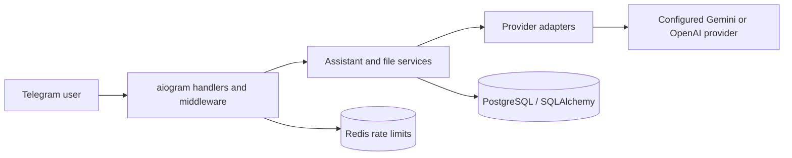

# Uzbek AI Assistant — Telegram Bot

    

## Overview

Yordamchi-Bot is an Uzbek-language Telegram assistant built with aiogram. It routes user requests to configured language-model providers and includes productivity and file-oriented workflows. The repository contains the bot, persistence and rate-limit infrastructure, container setup, and tests.

## Features

- AI chat with conversation context, idea generation, decision support, problem analysis, and coding assistance.
- Text drafting, rewriting, summarization, translation, planning, and formal/social copy.
- Image analysis and OCR through the configured multimodal model.
- Voice transcription through Gemini or OpenAI Whisper, depending on the configured provider; Uzbek text-to-speech uses Edge TTS.
- PDF text extraction, summarization, question answering, and analysis, with file/page limits.
- Personal notes with create, list, search, and delete flows.
- Natural-language reminders with a background scheduler and configurable timezone.
- Education and entertainment handlers, user activity statistics, admin statistics, and conversation reset/settings flows.
- Persistent user, conversation, message, note, reminder, and AI usage records using async SQLAlchemy.
- Redis-backed rate limiting and configurable per-feature token limits.
- Docker Compose environment for the bot, PostgreSQL, and Redis.

Provider-specific capabilities depend on valid API credentials, model availability, and configuration. This repository does not guarantee that third-party services are active.

## Screenshots

No Telegram screenshots are tracked in the repository. Add genuine bot screenshots after removing any personal information from the captured chats.

## Technology stack

| Area | Technology |
|---|---|
| Telegram interface | Python, aiogram 3 |
| AI and voice | Gemini/OpenAI-compatible model clients, OpenAI Whisper fallback, Edge TTS, pypdf |
| Persistence | PostgreSQL, SQLAlchemy async, asyncpg, Alembic |
| Rate limiting/cache | Redis |
| Operations | Docker, Docker Compose, pytest |

## Architecture



Handlers coordinate Telegram updates; service modules implement the application workflows; provider and storage integrations are configured through environment variables. Database schema changes are tracked through Alembic.

## Repository layout

```text
app/bot/         Telegram handlers, filters, keyboards, middleware, and FSM states
app/config/      Pydantic settings
app/database/    SQLAlchemy models and async session management
app/services/    AI, document, note, reminder, and speech services
migrations/      Alembic migration environment and revisions
tests/           AI, error handling, notes, PDF/speech, rate-limit, reminder, and user tests
main.py          Bot application entry point
Dockerfile
docker-compose.yml
requirements.txt
```

## Installation

### Docker Compose

```bash
cp .env.example .env
# Set the bot token and only the provider keys you intend to use.
docker compose up --build
```

The included Compose file defines PostgreSQL, Redis, and the bot. Review its local-development credentials and do not reuse them in a public deployment.

### Local Python environment

```bash
python -m venv .venv
source .venv/bin/activate
pip install -r requirements.txt
cp .env.example .env
```

Start the configured PostgreSQL and Redis services, apply database migrations with Alembic as documented in the repository, then start the bot with `python main.py`.

## Environment variables

Use `.env.example` for the complete current list. Never commit real credentials.

| Variable group | Purpose |
|---|---|
| `BOT_TOKEN`, `ADMIN_ID` | Telegram bot identity and administrator |
| `AI_PROVIDER`, `GEMINI_*`, `OPENAI_*` | Model selection and provider credentials/models |
| `DATABASE_URL` | PostgreSQL connection |
| `REDIS_URL` | Rate limiting and cache |
| `*_MAX_TOKENS` | Per-feature response limits |
| `RATE_LIMIT_*` | Request limits |
| `MAX_FILE_SIZE_MB`, `MAX_PDF_PAGES` | Input limits |
| `TTS_VOICE_UZBEK`, `DEFAULT_TIMEZONE` | Uzbek voice and reminder timezone configuration |

## API documentation

This repository is a Telegram bot; it does not expose a documented public REST API. Users interact through Telegram commands, buttons, and conversations. The internal service and database interfaces are not public API contracts.

## Database structure

The application persists Telegram users, conversations/messages, notes and reminders, and AI usage-related records. PostgreSQL models and migrations define the current schema. Redis is used for transient rate-limit/cache state.

## Usage

1. Create a Telegram bot and set `BOT_TOKEN`.
2. Configure an administrator ID and at least one supported AI provider key.
3. Start PostgreSQL and Redis, apply migrations, and run the bot.
4. Open the bot in Telegram and follow its available commands and button flows.

## Deployment

Docker Compose is provided for a self-managed deployment. For a managed host, run the bot as a long-lived worker process and provision PostgreSQL and Redis separately. Supply credentials through the host's secret manager, configure persistent database backups, and monitor Telegram/provider errors. The repository does not confirm a live Railway or other hosting connection.

## Security notes

- Do not use placeholder/default bot, database, or provider credentials outside local development. The checked-in Compose file contains local database defaults; replace them before exposing services.
- Treat conversation content, uploaded files, and API keys as sensitive data. Define retention and access policies before operating the bot for real users.
- Do not log raw provider tokens or private user content unnecessarily.
- Make external-provider calls resilient to timeouts, quotas, and unavailable models.

## Tests

The repository includes test modules that mock external providers and Telegram interactions. Run them in the configured Python environment with `pytest`; this README does not claim a passing test run.

## Future improvements

- Add CI checks and an explicit supported Python version matrix.
- Document commands and provider-specific feature requirements from the current handlers.
- Add consent, retention, deletion, and data-export documentation for user content.
- Add redacted screenshots and operational monitoring guidance.
